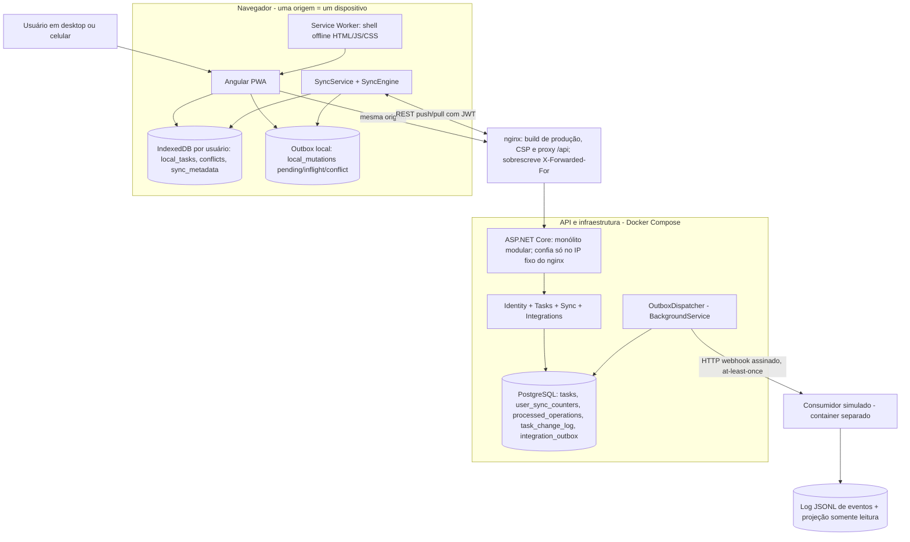

# Way2 — Todo List Offline-First

> Desafio técnico *Aplicação Todo List Offline-First* (Way2 Technology).
>
> **Estado: entrega final.** Fases A (fundação), B (offline e sincronização), C (integração externa) e D (revisão, hardening e documentação) concluídas, com build e testes verdes a partir de um checkout limpo.

## Visão geral

Uma lista de tarefas que funciona **de verdade** sem conexão, no desktop e no celular, e sincroniza sozinha quando o servidor volta:

- A interface lê e grava sempre no **IndexedDB** do navegador, inclusive online. Cada escrita grava a tarefa e a operação pendente na **mesma transação**.
- O **PWA** (Angular Service Worker) abre e recarrega o app sem rede depois do primeiro acesso.
- Um protocolo de **push/pull** com `operationId` estável, `baseVersion` e cursor por usuário garante que retries não duplicam, edições concorrentes viram **conflito explícito** (nunca sobrescrita silenciosa) e exclusões não ressuscitam.
- Cada mudança aceita grava, no mesmo commit, um evento numa **Transactional Outbox**. Um worker entrega os eventos por **webhook assinado** a um consumidor externo, com retry durável, at-least-once e ordem por tarefa.
- Tarefas com a palavra **urgente** sobem para o topo na hora, também offline.

A arquitetura é um **monólito modular** (ASP.NET Core + PostgreSQL + Angular), sem broker nem microsserviços: a escala pedida (~1.000 usuários simultâneos) não justifica esse custo.

## Requisitos atendidos

| Requisito do enunciado | Como foi atendido | Evidência |
|---|---|---|
| CRUD de tarefas (título, descrição, vencimento, prioridade, status) | Formulário Angular; escrita local + operação pendente na mesma transação IndexedDB; servidor só via `POST /api/sync/push` | Testes do repositório local, da página e do `TaskCommandService` contra PostgreSQL real |
| Autenticação e isolamento por usuário | JWT (HS256 fixo); `userId` só do token; um banco IndexedDB por usuário | Testes com dois usuários (push, pull, `/api/tasks`, outbox); usuário B nunca vê dados de A |
| Agrupamento por categoria, filtros e busca, também offline | Calculados no cliente sobre o IndexedDB | Testes de `task-view` e da página |
| Prioridade para "urgente" (palavra inteira, sem caixa), inclusive offline | Regra pura no cliente; seção **Urgentes** no topo | Testes de urgência (caixa, palavra inteira, acentos, descrição, `urgentemente` não conta) + roteiro offline real no Edge headless |
| Uso offline real no celular após a primeira carga | PWA com Service Worker; dados no IndexedDB | `verify-pwa-offline`: containers **parados**, app recarregado pelo Service Worker, CRUD offline, sincronização automática na volta |
| Sincronização automática e estado visível | `SyncEngine` com sonda real (`/api/health`), backoff, gatilhos; indicador com 7 estados | 19 cenários do engine + 11 do serviço; `navigator.onLine` nunca é prova de conexão |
| Conflitos entre dispositivos sem perda | `baseVersion`, conflito explícito, painel "sua versão × servidor" | 17 testes de resolução + conflito real entre dois dispositivos no navegador |
| Integração externa quase em tempo real, somente leitura | Outbox no mesmo commit, `OutboxDispatcher`, webhook HMAC, consumidor idempotente | Testes de outbox e dispatcher (500, timeout, 3xx/4xx, backoff, ordem estrita, concorrência, reinício), 9 do consumidor e 2 de ponta a ponta; 503, consumidor fora do ar e ack perdido validados com Docker |
| Dimensionamento para ~1.000 usuários | API stateless, lock por usuário, índices por chave, paginação | Estimativa explícita na seção [Dimensionamento](#dimensionamento) (**não** é medição) |

## Tecnologias e por quê

| Camada | Escolha | Por quê |
|---|---|---|
| Backend | .NET 10, ASP.NET Core Minimal APIs | Stack pedida; Minimal APIs mantêm os endpoints pequenos e próximos de cada módulo |
| Persistência | PostgreSQL 17 + EF Core 10 (Npgsql) | Transações por operação, `SELECT … FOR UPDATE`, `SKIP LOCKED` para a outbox, tudo num banco só |
| Frontend | Angular 21.2 (LTS), standalone, zoneless, Signals | Angular 22 exige Node ≥ 24.15 e o ambiente tem 24.14; migrar é um `ng update` |
| Dados locais | IndexedDB via Dexie 4, durabilidade `strict` | Transações, índices e espaço que o `localStorage` não oferece |
| Offline | `@angular/service-worker` (mesma versão do core) | Cache do shell para abrir e recarregar sem rede; não guarda dados de tarefa |
| Entrega externa | Transactional Outbox + `BackgroundService` + webhook HMAC | Durável e ordenada sem broker |
| Testes | xUnit + Testcontainers (PostgreSQL real), Vitest + fake-indexeddb, Edge headless via CDP | Cada camada testada contra a dependência real sempre que possível |
| Execução | Docker Compose (db, api, web/nginx, consumer) | Um comando sobe tudo, inclusive o build de produção com Service Worker |

## Como executar

### Pré-requisitos

- Docker Desktop com Compose v2 (testado com Docker 28.0.4 e Compose 2.34).
- Para rodar testes e o frontend fora do Docker: .NET SDK 10.0.x (testado com 10.0.401) e Node.js 24.x com npm 11 (testado com 24.14 e 11.9).
- Para a verificação automatizada do PWA: Edge ou Chrome instalado.

### Tudo em Docker (build de produção, com Service Worker)

```bash
docker compose up --build -d
```

| Serviço | Endereço |
|---|---|
| App (nginx: build de produção, CSP e proxy `/api`) | `http://localhost:4280` |
| API (aplica migrations e cria os usuários de demonstração ao iniciar) | `http://localhost:5080` |
| PostgreSQL | `localhost:5433` (5433 para não colidir com uma instalação local) |
| Consumidor webhook simulado (painel, `GET /events`, `GET /tasks`, `PUT/DELETE /failure-mode`) | `http://127.0.0.1:5090` |

- Todas as portas são publicadas **só em `127.0.0.1`**. Para expor na rede local, troque o prefixo no `docker-compose.yml` conscientemente. Fora de `localhost`, o Service Worker exige HTTPS.
- A rede do compose usa a sub-rede `172.30.240.0/24`, com o nginx em `172.30.240.10`: é o único proxy em que a API confia para o IP do cliente. Se colidir com outra rede, ajuste `COMPOSE_SUBNET` e `WEB_PROXY_IP` no `.env` (veja `.env.example`).
- Portas, senhas e segredos são sobrescritos por um `.env` opcional. Os padrões são **apenas de desenvolvimento**.
- Atualizando um ambiente de uma versão anterior: `docker compose up --build -d` recria a rede e os containers e mantém os volumes. Testado: os dados ficaram idênticos.

### Desenvolvimento

```bash
docker compose up -d db api
```

```bash
cd src/frontend/todo-web
npm ci
npm start
```

O dev server (`http://localhost:4200`) encaminha `/api` para `http://localhost:5080` (`proxy.conf.json`) e **não** registra Service Worker nem aplica a CSP do nginx. Alternativa à API em container: `docker compose stop api` e `dotnet run --project src/backend/Way2.Todo.Api` (ambiente `Development`, mesma porta).

No Windows, pare o `npm start` antes de rodar `npm ci` de novo: o dev server segura o `esbuild.exe`, o `npm ci` falha com `EPERM` depois de apagar parte do `node_modules`, e o servidor passa a mostrar `TS6053`. Pare o servidor, rode `npm ci` e inicie de novo.

### Credenciais de demonstração

| E-mail | Senha |
|---|---|
| `demo@way2.local` | `Way2Demo!2026` |
| `demo2@way2.local` | `Way2Demo!2026` |

São valores **apenas de desenvolvimento**, definidos em `appsettings.Development.json` e nos padrões do `docker-compose.yml` (sobrescreva com `DEMO_PASSWORD`). No banco ficam só os hashes. Em `appsettings.json` o seed vem desligado e não há chave JWT: a API não sobe sem configuração explícita.

## Roteiro rápido de demonstração

Cada origem é um "dispositivo", com IndexedDB, sessão e Service Worker próprios: abra **A** em `http://localhost:4280` e **B** em `http://127.0.0.1:4280`, com o mesmo usuário nos dois.

1. **Urgente:** crie "Ligar para o cliente URGENTE": a tarefa vai para a seção Urgentes na hora.
2. **Offline:** `docker compose stop api`. O indicador mostra *Sem conexão com o servidor* (com `navigator.onLine` ainda `true`). Crie, edite, conclua e exclua.
3. **Recarga sem servidor:** `docker compose stop web` e recarregue. O app abre pelo Service Worker, com os dados locais.
4. **Reconexão:** `docker compose start api web`. A sincronização retoma sozinha, e B recebe.
5. **Conflito:** com a API parada, edite a mesma tarefa em A e B e religue a API. Quem sincroniza depois vê o painel com as duas versões e decide.
6. **Webhook:** com o painel do consumidor aberto (`http://127.0.0.1:5090`), cada mudança aceita chega em menos de 1s. Para simular falha:
   ```bash
   curl -X PUT http://127.0.0.1:5090/failure-mode -H "Content-Type: application/json" -d "{\"statusCode\":503,\"remaining\":2}"
   ```
   A terceira tentativa entrega; `GET /api/integrations/outbox` mostra as tentativas.

## Testes

```bash
dotnet test Way2.Todo.slnx
```

**93 testes** no backend: 30 unitários (domínio, JWT, backoff, consumidor em memória) e 63 de integração com PostgreSQL real via Testcontainers (exigem Docker em execução), incluindo 2 de ponta a ponta com a API real entregando ao consumidor real. Sem Docker, só os unitários:

```bash
dotnet test Way2.Todo.slnx --filter "Category!=Integration"
```

Frontend (**164 testes**, IndexedDB em memória com `fake-indexeddb`) e build de produção:

```bash
cd src/frontend/todo-web
npm test -- --watch=false
npm run build
```

Os testes de sincronização do frontend usam um servidor em memória com as regras do contrato (`core/sync/testing/`, só para testes), que simula no momento exato timeout depois do commit, API fora do ar, 401 e dois dispositivos.

**Verificação real do PWA offline** (Edge ou Chrome headless com perfil temporário; com o compose no ar):

```bash
DEMO_PASSWORD=Way2Demo!2026 node scripts/verify-pwa-offline.mjs
```

O script confere se o Service Worker está ativo e controlando a página e então **para de verdade** os containers `web` e `api`. Em seguida recarrega, cria, edita, conclui e exclui offline, religa os containers e espera a sincronização automática. No fim, confere os cabeçalhos de segurança e falha se houver qualquer violação de CSP. Aceita `WEB_ORIGIN` e `COMPOSE_PROJECT_NAME`, para rodar contra um projeto compose isolado.

**Última execução (29/10/2026), a partir de um clone limpo num projeto compose isolado:** backend 93/93, frontend 164/164, `npm audit` sem vulnerabilidades, build de produção sem avisos, `verify-pwa-offline` aprovado sem violações de CSP e webhook validado com falha e recuperação.

## Arquitetura



*(Fonte: [`docs/diagrams/01-context.mmd`](docs/diagrams/01-context.mmd). Fluxo de sincronização: [`02-sync-flow.mmd`](docs/diagrams/02-sync-flow.mmd). Integração externa: [`03-external-integration.mmd`](docs/diagrams/03-external-integration.mmd).)*

| Módulo (backend) | Responsabilidade |
|---|---|
| `Identity` | Login, emissão e validação do JWT, seed de demonstração, rate limit do login |
| `Tasks` | Domínio puro (`TodoTask`, `TaskFields`): validação, versão, exclusão lógica; `TaskCommandService` |
| `Sync` | Push/pull, idempotência por `operationId` + `request_hash`, contador por usuário, change log |
| `Integrations` | Evento na outbox, `OutboxDispatcher`, assinatura HMAC, monitoramento |
| `Infrastructure` | `TodoDbContext`, migrations e confiança no proxy reverso |

No frontend: `core/auth` (sessão, guards), `core/offline` (Dexie e `LocalTaskRepository`), `core/sync` (`SyncStore` transacional, `SyncEngine`, `SyncService`) e `features/tasks` (urgência, filtros, tela, formulário, painel de conflitos).

## Fluxo offline-first

1. **Escrita local:** a tarefa e a operação `pending` (com `operationId` novo e a `baseVersion` conhecida) são gravadas numa única transação IndexedDB. A lista se atualiza pelo `liveQuery`, sem esperar a rede.
2. **Coalescência:** edições seguidas de uma operação ainda não enviada viram uma só. Criar e excluir antes do primeiro envio se anulam.
3. **Sonda real:** antes de congelar qualquer coisa, o cliente chama `GET /api/health`. Sem resposta, fica `offline`, e as edições continuam coalescendo.
4. **Push:** a cabeça da fila de cada tarefa passa de `pending` para `inflight`. A partir daí, `operationId`, `baseVersion` e payload ficam **congelados**, e um retry reenvia exatamente a mesma operação.
5. **Servidor:** uma transação por operação. Trava o contador do usuário, deduplica por `operationId` + `request_hash`, confere `baseVersion`, grava tarefa, revisão, change log, `processed_operations` e evento da outbox, e faz commit.
6. **Ack:** remove a operação, rebaseia a próxima da mesma tarefa na versão confirmada e nunca sobrescreve uma edição local mais nova.
7. **Pull:** só sem operações `inflight`. Cada página e o cursor são aplicados na mesma transação; tarefas com edição local guardam o snapshot remoto em vez de serem sobrescritas.
8. **Gatilhos:** início, evento `online`, foco, visibilidade, escrita local (debounce de 1s), ciclo de 30s e backoff de 1s a 60s. Uma execução por vez (mutex na aba + Web Locks entre abas). A sincronização roda **com o app aberto**: não há Background Sync com o navegador fechado.

## Conflitos

- Toda escrita carrega a `baseVersion`. Se o servidor tem outra versão, responde `conflict` com o snapshot atual, **sem gravar nada e sem gerar evento**.
- A fila da tarefa para; as outras seguem. O painel mostra a cópia local e a do servidor lado a lado.
- **"Usar versão do servidor"** descarta as intenções locais. **"Manter minha alteração"** cria uma **nova** operação (novo `operationId`, `baseVersion` = versão do servidor). É uma decisão explícita, nunca um retry cego.
- Contra uma exclusão no servidor, "Manter" recria o conteúdo como **nova** tarefa: o registro excluído nunca ressuscita.
- Um formulário de edição aberto enquanto chega a mudança de outro dispositivo também vira conflito ao salvar, em vez de sobrescrever.

## Integração externa e garantias

| Garantia | Como |
|---|---|
| Evento só de mudança confirmada | Gravado na outbox no **mesmo commit** do push; nunca para `duplicate`, `conflict` ou `validation_error` |
| Só o servidor fala com o consumidor | O cliente nunca envia nada ao parceiro externo |
| At-least-once (nunca exactly-once) | Só `2xx` marca entregue; timeout ou ack perdido geram nova entrega do mesmo `eventId` |
| Idempotência no consumidor | Deduplicação por `eventId`; repetição responde `duplicate: true` sem repetir o efeito |
| Ordem por tarefa | Nenhum evento sai enquanto houver um anterior da mesma tarefa pendente; o consumidor ainda aplica só versões mais novas |
| Retry durável | Backoff `2s × 2^(n-1)`, teto de 5 min, jitter de ±20%, sem descarte; consumidor fora do ar recebe uma tentativa por janela |
| Autenticidade | `X-Way2-Signature: t=…,v1=HMAC-SHA256`, com timestamp novo a cada tentativa e janela de ±5 min |
| Retomada | Tudo no PostgreSQL; reserva com `claim_token` e lease; seguro com várias instâncias (`SKIP LOCKED`) |

Contrato completo em [SYNC_CONTRACT §6](docs/SYNC_CONTRACT.md#6-integração-externa-webhook-contrato-de-eventos-v1).

## Segurança

CSP estrita e cabeçalhos de segurança no nginx; rate limit do login por IP real do cliente (só o nginx é proxy confiável e ele sobrescreve `X-Forwarded-For`); JWT com algoritmo fixo; isolamento por usuário em todas as consultas; limite de 1 MiB no push; validação de entrada com erro por operação; segredos só por configuração; logs sem senha, token ou conteúdo de tarefa; portas só em `127.0.0.1`; `npm audit` e `dotnet list package --vulnerable` limpos.

## Dimensionamento

Para ~1.000 usuários com o app aberto, a estimativa a partir do comportamento do código é de **~120 requisições/s** em regime e **~17 pushes/s**. Cada push trava só a linha do contador do próprio usuário (sem disputa entre usuários), e consultas e dedupe usam índices pela chave. A API é stateless e o dispatcher é seguro com várias instâncias.

**Não houve teste de carga**: esses números são estimativa, com as premissas e os gargalos conhecidos (dispatcher sequencial por instância, custo do login, crescimento do change log).

## Decisões e trade-offs

| Decisão | Alternativa descartada | Trade-off aceito |
|---|---|---|
| Monólito modular, um projeto de API | Microsserviços + broker | Menos isolamento de deploy; muito menos operação |
| Outbox no PostgreSQL | Kafka/RabbitMQ | Vazão limitada pelo dispatcher; suficiente para a escala pedida |
| Conflito explícito por `baseVersion` | Last-write-wins, merge automático | O usuário às vezes precisa decidir; nunca há perda silenciosa |
| IndexedDB como fonte da UI, inclusive online | Ler da API quando online | Mais lógica no cliente; um único caminho de leitura, offline de verdade |
| Uma transação por operação no push | Uma transação por lote | Mais commits; um erro numa operação não derruba as outras |
| Lock do contador por usuário | Sequence global | Serializa só o mesmo usuário; o cursor nunca pula revisão ainda não confirmada |
| Sincronização com o app aberto | Background Sync | Suporte desigual entre navegadores; não prometer o que não funciona em todos |
| Sem refresh token | Refresh token rotativo | Login online a cada 8h para sincronizar; edição local nunca bloqueia |
| CSP sem `'unsafe-inline'` | CSP permissiva | Exige `inlineCritical` desligado (um CSS a mais no carregamento inicial) |

## Premissas

- **Urgente:** palavra inteira `urgente` no título ou na descrição, sem diferenciar caixa. `urgentemente` e `urgentes` não contam; `não urgente` conta (a regra é literal).
- **Ordenação:** urgentes primeiro, depois vencimento crescente (sem vencimento por último), criação e id. Os filtros são aplicados antes.
- **`dueDate`** é data civil (`YYYY-MM-DD`), nunca convertida para UTC; instantes são UTC ISO 8601.
- **Categoria** é obrigatória (padrão `Geral`) e o agrupamento ignora caixa.
- **Logout** remove só a sessão: tarefas e pendências do usuário ficam no banco local dele e voltam após novo login do mesmo usuário.
- **Primeiro acesso** exige rede (login); depois, o usuário já autenticado usa os dados locais offline.

## Limitações conhecidas

- **Só com o app aberto:** não há Background Sync; nada sincroniza com o navegador fechado.
- **Durabilidade do IndexedDB:** `strict` reduz, mas não elimina, o risco de perder a última escrita numa queda do aparelho; o suporte varia entre navegadores.
- **Web Locks** só existe em contexto seguro; sem ele vale o mutex da aba, e acks repetidos continuam inofensivos.
- **Dados locais não são criptografados** (IndexedDB e sessão no `localStorage`); a proteção depende do dispositivo e da CSP.
- **Sem refresh token:** após 8h é preciso novo login online para sincronizar.
- **Change log e outbox sem retenção:** um dispositivo novo baixa todo o histórico do usuário.
- **Rate limit em memória**, por instância.
- **Dispatcher sequencial** por instância: com um consumidor lento, a fila cresce (mitigação: mais instâncias).
- **Erro permanente num webhook** (por exemplo, 400 recorrente) bloqueia só a sua tarefa até intervenção manual (documentada); não há dead letter automático.
- **Atualização do app** chega pelo Service Worker na recarga seguinte, sem aviso de "nova versão".
- **Validação do Service Worker:** o navegador embutido usado no desenvolvimento não registra Service Workers, então a recarga offline foi validada com Edge headless.

## Demonstração × produção

Esta entrega é configurada para demonstração local (HTTP em `localhost`, segredos *dev-only*, seed de usuários, migrations no startup). Para produção, a recomendação é:

- TLS e HSTS;
- segredos num secret manager, com rotação da chave JWT;
- seed desligado (já é o padrão fora de `Development`);
- migrations como etapa do deploy;
- IPs reais do balanceador em `ReverseProxy:KnownProxies`;
- rate limit distribuído;
- refresh token em cookie `HttpOnly`;
- retenção do change log e da outbox.

## Evoluções possíveis

- Snapshot inicial + retenção do change log; expurgo de eventos entregues.
- Refresh token rotativo e aviso de "nova versão disponível" no PWA.
- Paralelizar o dispatcher por tarefa dentro do lote; dead letter com reprocessamento manual pela interface.
- Notificação em tempo real para clientes online (SignalR) como **gatilho** de pull, sem substituir o protocolo.
- Background Sync como melhoria progressiva onde houver suporte.
- Teste de carga com o ciclo real do cliente (k6) antes de produção.

## Configuração

| Variável (API) | Uso |
|---|---|
| `ConnectionStrings__Todo` | Conexão PostgreSQL |
| `Jwt__SigningKey` | Chave HMAC, **obrigatória** (mínimo 32 bytes); a API não sobe sem ela |
| `Jwt__Issuer`, `Jwt__Audience`, `Jwt__AccessTokenMinutes` | Padrões em `appsettings.json` (token de 8h) |
| `Database__ApplyMigrationsOnStartup` | Aplica migrations ao iniciar (dev/demo) |
| `DemoSeed__Enabled`, `DemoSeed__Users__N__Email`, `DemoSeed__Users__N__Password` | Usuários de demonstração (desligado por padrão) |
| `ReverseProxy__KnownProxies__N` | IPs dos proxies confiáveis para `X-Forwarded-For`; vazio = nenhum cabeçalho é aceito |
| `Webhook__Url`, `Webhook__Secret` | Destino dos webhooks e segredo HMAC (mínimo 32 bytes, validado no startup). Sem URL, os eventos ficam pendentes na outbox. |
| `Webhook__TimeoutSeconds` | Timeout por requisição (padrão 10) |
| `Outbox__PollIntervalSeconds`, `Outbox__BatchSize`, `Outbox__LeaseSeconds`, `Outbox__BaseBackoffSeconds`, `Outbox__MaxBackoffSeconds`, `Outbox__DispatcherEnabled` | Dispatcher (padrões 2s, 20, 30s, 2s, 300s, ligado) |
| `Consumer__WebhookSecret`, `Consumer__DataPath` (consumidor) | Segredo compartilhado e caminho do log JSONL |

O `docker-compose.yml` lê `POSTGRES_*`, `API_PORT`, `WEB_PORT`, `CONSUMER_PORT`, `COMPOSE_SUBNET`, `WEB_PROXY_IP`, `JWT_SIGNING_KEY`, `WEBHOOK_SECRET`, `DEMO_SEED_ENABLED` e `DEMO_PASSWORD` de um `.env` opcional (veja `.env.example`).

## Endpoints

| Método | Rota | Autenticação | Descrição |
|---|---|---|---|
| `POST` | `/api/auth/login` | — | `accessToken`, `expiresAt` e `user`; 401 genérico; 20 tentativas/min por IP do cliente |
| `GET` | `/api/health` | — | Conectividade com o banco; sonda real do `SyncEngine` |
| `POST` | `/api/sync/push` | Bearer | 1–50 operações, corpo até 1 MiB; resultado por operação: `applied`, `duplicate`, `conflict` ou `validation_error` |
| `GET` | `/api/sync/pull?cursor=N&limit=M` | Bearer | Mudanças do usuário com `revision > N` (`limit` padrão 100, máximo 500), incluindo tombstones |
| `GET` | `/api/tasks` | Bearer | Tarefas ativas do usuário (leitura auxiliar) |
| `GET` | `/api/integrations/outbox` | Bearer | Entrega dos webhooks **do próprio usuário**: pendentes, em retry, entregues, idade do mais antigo, tarefas bloqueadas e últimos eventos |
| `POST` | `/webhooks/todo-events` (consumidor) | HMAC | Evento v1 (`task.created`, `task.updated`, `task.deleted`) |

Contrato completo: [`docs/SYNC_CONTRACT.md`](docs/SYNC_CONTRACT.md).

## Estrutura

```text
docker-compose.yml, Way2.Todo.slnx, .env.example
scripts/verify-pwa-offline.mjs      # verificação real do PWA offline (Chromium headless + docker compose)
src/backend/Way2.Todo.Api/          # Identity/, Tasks/, Sync/, Integrations/, Infrastructure/ (monólito modular)
src/backend/Way2.Todo.Tests/        # xUnit: unitários + integração + ponta a ponta com o consumidor
src/consumer/Way2.Todo.Consumer/    # consumidor webhook simulado (container separado)
src/frontend/todo-web/              # Angular: core/auth, core/offline, core/sync, features/tasks; Dockerfile, nginx.conf, security-headers.conf
docs/                               # contrato de sincronização e diagramas
```

## Como o Claude Code foi utilizado

Desenvolvi este projeto com apoio do **Claude Code** (Anthropic) em todas as fases. A divisão de papéis foi clara: o Claude Code propôs planos, escreveu código, testes e documentação; eu conduzi a direção técnica e decidi o que entrava.

**Meu papel:**

- **Direção e escopo.** Dividi o trabalho em fases (A a D), com parada obrigatória ao fim de cada uma para revisão, commits locais progressivos e nenhum push. Fixei restrições permanentes: nada de microsserviços, broker ou dependências sem necessidade demonstrada; nenhuma operação destrutiva nos dados; nada afirmado como testado sem evidência.
- **Revisão de cada plano antes do código.** Cada fase começou com um plano revisado antes do código. Aprovei os planos com ajustes técnicos concretos, entre eles:
  - logout preservando o IndexedDB do usuário;
  - novo `operationId` no "Manter minha alteração";
  - atomicidade entre tarefa e operação no IndexedDB;
  - identidade da operação por `request_hash`, para recusar reuso de `operationId` com outro conteúdo;
  - não assumir `serverVersion = 1` após a criação;
  - ressalva explícita sobre os limites da durabilidade `strict` do IndexedDB;
  - verificação real do Service Worker com os servidores parados;
  - ordem estrita por tarefa na entrega dos webhooks;
  - timestamp e assinatura HMAC novos a cada tentativa.
- **Exigência de causa raiz.** No erro `TS6053` do dev server, pedi a investigação da causa (um `npm ci` interrompido por `EPERM` com o servidor rodando), sem mascarar o `tsconfig`.
- **Hardening da Fase D.** Na Fase D, exigi:
  - que um erro de dados do PostgreSQL (SQLSTATE 22) fizesse rollback só da operação afetada, validado com o cenário [válida, inválida, válida];
  - que o `ForwardedHeaders` confiasse exclusivamente no proxy controlado pela aplicação, com testes de proxy confiável e não confiável;
  - que o teste de carga, se feito, fosse rotulado como não representativo. Ele acabou não sendo feito, por prioridade.
- **Critério de aceite.** Toda entrega precisou vir com build, testes e evidência observável. Decidi o que seguia, o que voltava e o que ficava como limitação documentada.

**Como o código foi revisado e testado:**

- **Revisão do desenho antes do código.** Os desenhos da sincronização (Fase B) e da outbox (Fase C) passaram por uma revisão independente. Foram encontrados, entre outros:
  - fila travada por operação recusada;
  - sobrescrita silenciosa;
  - entrega fora de ordem com duas instâncias;
  - dois relógios (o do app e o `now()` do PostgreSQL);
  - estouro no backoff;
  - redirect convertendo POST em GET.

  Tudo foi corrigido antes da implementação.
- **Revisão final da Fase D.** A análise do Claude Code, somada a uma nova revisão independente, levantou 14 achados. Todos foram corrigidos, com teste automatizado ou, no caso da publicação das portas, verificação documentada. Os mais graves:
  - um formulário de edição aberto durante um pull podia sobrescrever a mudança de outro dispositivo sem conflito;
  - um caractere nulo num título travava a fila inteira com 500;
  - atrás do nginx, todos os usuários dividiam o mesmo limite de login.
- **Testes de mutação.** Cada correção relevante veio com um teste que **falha** quando a correção é desligada, conferido na prática, além do teste da ordem estrita dos webhooks.
- **Validação real.**
  - Navegador com dois dispositivos (`localhost` e `127.0.0.1`), em 375px e desktop.
  - Edge headless parando de verdade os containers para provar a recarga offline.
  - Docker Compose com consumidor falhando, fora do ar e com ack perdido.
  - Clone limpo do repositório num projeto compose isolado, sem tocar no ambiente original.

## Documentação

- [`docs/SYNC_CONTRACT.md`](docs/SYNC_CONTRACT.md): contratos HTTP, idempotência, conflitos e eventos de integração.
- [`docs/diagrams/`](docs/diagrams/): diagramas Mermaid (contexto, sincronização, integração externa), fiéis ao código.
