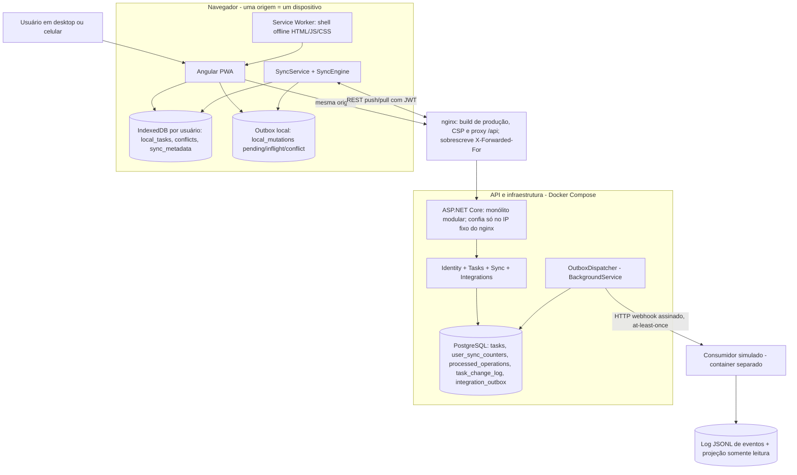

# Way2 — Todo List Offline-First

> Desafio técnico *Aplicação Todo List Offline-First* (Way2 Technology).
>
> **Entrega final:** aplicação funcional com uso offline real, sincronização automática, resolução de conflitos e integração externa por webhook, com build e testes verdes a partir de um clone limpo.

## Sumário

- [Visão geral](#visão-geral)
- [Requisitos do desafio e como foram atendidos](#requisitos-do-desafio-e-como-foram-atendidos)
- [Tecnologias e por quê](#tecnologias-e-por-quê)
- [Como executar](#como-executar)
- [Roteiro de demonstração](#roteiro-de-demonstração)
- [Testes](#testes)
- [Arquitetura](#arquitetura)
- [Estratégia offline-first](#estratégia-offline-first)
- [Idempotência e consistência no servidor](#idempotência-e-consistência-no-servidor)
- [Conflitos](#conflitos)
- [Regra de urgência e ordenação](#regra-de-urgência-e-ordenação)
- [Integração externa: Transactional Outbox e garantias](#integração-externa-transactional-outbox-e-garantias)
- [Segurança](#segurança)
- [Dimensionamento para ~1.000 usuários simultâneos](#dimensionamento-para-1000-usuários-simultâneos)
- [Decisões e trade-offs](#decisões-e-trade-offs)
- [Premissas e decisões de implementação](#premissas-e-decisões-de-implementação)
- [Limitações conhecidas](#limitações-conhecidas)
- [Demonstração × produção](#demonstração--produção)
- [Evoluções possíveis](#evoluções-possíveis)
- [Configuração e endpoints](#configuração-e-endpoints)
- [Estrutura do repositório](#estrutura-do-repositório)
- [Desenvolvimento assistido por IA](#desenvolvimento-assistido-por-ia)

## Visão geral

Uma lista de tarefas que funciona **de verdade** sem conexão, no desktop e no celular, e sincroniza sozinha quando o servidor volta:

- A interface lê e grava sempre no **IndexedDB** do navegador, inclusive online. Cada escrita grava a tarefa e a operação pendente na **mesma transação**.
- O **PWA** (Angular Service Worker) abre e recarrega o app sem rede depois do primeiro acesso.
- Um protocolo de **push/pull** com `operationId` estável, `baseVersion` e cursor por usuário garante que retries não duplicam, edições concorrentes viram **conflito explícito** (nunca sobrescrita silenciosa) e exclusões não ressuscitam.
- Cada mudança aceita grava, no mesmo commit, um evento numa **Transactional Outbox**. Um worker entrega os eventos por **webhook assinado** a um consumidor externo, com retry durável, at-least-once e ordem por tarefa.
- Tarefas com a palavra **urgente** sobem para o topo na hora, também offline.

A arquitetura é um **monólito modular** (ASP.NET Core + PostgreSQL + Angular), sem broker nem microsserviços: a escala pedida (~1.000 usuários simultâneos) não justifica esse custo ([por quê](#por-que-um-monólito-modular)).

## Requisitos do desafio e como foram atendidos

| Requisito | Como foi atendido | Evidência |
|---|---|---|
| CRUD de tarefas (título, descrição, vencimento, prioridade, status) | Formulário Angular; escrita local + operação pendente na mesma transação IndexedDB; servidor só via `POST /api/sync/push` | Testes do repositório local, da página e do `TaskCommandService` contra PostgreSQL real |
| Autenticação e isolamento por usuário | JWT (HS256 fixo); `userId` só do token; um banco IndexedDB por usuário | Testes com dois usuários (push, pull, `/api/tasks`, outbox); o usuário B nunca vê dados de A |
| Agrupamento por categoria, filtros e busca, também offline | Calculados no cliente sobre o IndexedDB | Testes de `task-view` e da página |
| Prioridade para "urgente" (palavra inteira, sem caixa), inclusive offline | Regra pura no cliente; seção **Urgentes** no topo | Testes de urgência (caixa, palavra inteira, acentos, descrição) + roteiro offline real no Edge headless |
| Uso offline real no celular após a primeira carga | PWA com Service Worker; dados no IndexedDB | `verify-pwa-offline`: containers **parados**, app recarregado pelo Service Worker, CRUD offline, sincronização automática na volta |
| Sincronização automática e estado visível | `SyncEngine` com sonda real (`/api/health`), backoff e gatilhos; indicador com 7 estados | 19 cenários do engine + 11 do serviço; `navigator.onLine` nunca é tomado como prova de conexão |
| Conflitos entre dispositivos sem perda | `baseVersion`, conflito explícito, painel "sua versão × servidor" | 17 testes de resolução + conflito real entre dois dispositivos no navegador |
| Integração externa quase em tempo real, somente leitura | Outbox no mesmo commit, `OutboxDispatcher`, webhook HMAC, consumidor idempotente | Testes de outbox e dispatcher (500, timeout, 3xx/4xx, backoff, ordem estrita, concorrência, reinício), do consumidor e 2 de ponta a ponta; 503, consumidor fora do ar e ack perdido validados com Docker |
| Dimensionamento para ~1.000 usuários | API stateless, lock por usuário, índices por chave, paginação | Estimativa explícita na seção [Dimensionamento](#dimensionamento-para-1000-usuários-simultâneos) (**não** é medição) |

### Rastreabilidade: requisito → código → testes

| Requisito | Código | Testes |
|---|---|---|
| CRUD e validação | `Tasks/TodoTask.cs`, `TaskFields.cs`, `TaskCommandService.cs`; `core/offline/local-task-repository.ts` | `TodoTaskTests`, `TaskFieldsTests`, `TaskCommandServiceTests`, `local-task-repository.spec.ts`, `tasks.page.spec.ts` |
| Autenticação e isolamento | `Identity/*`, `Sync/SyncEndpoints.cs`; `core/auth/*`, `local-database.ts` | `AuthApiTests`, `JwtTokenIssuerTests`, `TasksApiTests`, `SyncApiTests` (dois usuários), `OutboxTests` (monitoramento por usuário), `sync-engine.spec.ts` ("cada usuário sincroniza apenas o próprio banco"), `auth.spec.ts` |
| Categoria, filtros, busca, ordenação | `features/tasks/task-view.ts` | `task-view.spec.ts` |
| Urgente: palavra inteira, sem caixa, offline | `features/tasks/urgency.ts` | `urgency.spec.ts`, `tasks.page.spec.ts`, `verify-pwa-offline` |
| `dueDate` só data | `DateOnly` no backend (`date` no PostgreSQL); `local-date.ts` | `SyncApiTests` (`dueDate` inválida vira `validation_error` só na operação), `TasksApiTests`, `local-date.spec.ts` |
| PWA abre e recarrega offline | `ngsw-config.json`, `nginx.conf` | `verify-pwa-offline` (containers parados de verdade) |
| UI lê do IndexedDB; escrita e operação na mesma transação | `local-task-repository.ts` | "não grava nada quando a mutação falha no meio", "desfaz a edição local quando a nova mutação não pode ser gravada" |
| `operationId` preservado; operação em voo congelada; edição posterior não se perde no ack | `sync-store.ts` (`claimBatch`, `acknowledge`) | "nunca altera mutação in-flight", "operação reenviada após timeout é confirmada uma única vez", "timeout após o commit, edição local e retry", "edição durante o envio não é sobrescrita pelo ack" |
| `baseVersion` controla concorrência; conflito nunca sobrescreve | `TaskCommandService.cs`, `SyncService.cs`; `conflict-panel.ts` | `SyncApiTests` (conflitos, concorrência), `conflict-resolution.spec.ts`, "duas alterações concorrentes na mesma tarefa" |
| Cursor monotônico por usuário, sem perda na paginação | `SyncService` (contador por usuário, `PullAsync`); `applyPullPage` | `SyncApiTests` (revisões contíguas, paginação com pushes concorrentes), "pagina todas as mudanças sem perda", "página de pull interrompida não avança o cursor" |
| Tarefa, operação processada, change log e outbox na mesma transação | `SyncService.ApplyAsync` | `OutboxTests` (rollback forçado sem evento; nada em `duplicate`, `conflict` e `validation_error`) |
| Webhook só pelo servidor, após o commit, retries duráveis, dedupe por `eventId` | `Integrations/OutboxDispatcher.cs`; consumidor | `OutboxDispatcherTests`, `WebhookConsumerTests`, `WebhookEndToEndTests` |
| Exclusão como tombstone, sem ressurreição | `TodoTask.SoftDelete`; `applyPullPage` | "exclusão offline… replay antigo não ressuscita", testes de conflito com tombstone |
| Abas e dispositivos | `sync.service.ts` (mutex + Web Locks) | "dois engines no mesmo banco (sem Web Locks) não aplicam nada duas vezes", testes de dois dispositivos |
| Sessão expirada | `sync.service.ts`, `auth.service.ts` | "sessão expirada no servidor resulta em auth sem alterar a fila", testes de reautenticação |
| Interrupção (navegador fechado no meio) | `sync-store.ts` | "recupera a fila após interrupção, com nova instância do banco e do engine" |
| Sem credencial de produção no código; usuários de demonstração com hash | `appsettings.json` (seed desligado, sem chave), `DemoUserSeeder.cs` | `AuthApiTests`; a API não sobe sem `Jwt:SigningKey` |

## Tecnologias e por quê

| Camada | Escolha | Por quê |
|---|---|---|
| Backend | .NET 10, ASP.NET Core Minimal APIs | Stack pedida; Minimal APIs mantêm os endpoints pequenos e próximos de cada módulo |
| Persistência | PostgreSQL 17 + EF Core 10 (Npgsql) | Transações por operação, `SELECT … FOR UPDATE`, `SKIP LOCKED` para a outbox, tudo num banco só |
| Frontend | Angular 21.2 (LTS), standalone, zoneless, Signals | Angular 22 exige Node ≥ 24.15 e o ambiente tem 24.14; migrar é um `ng update` |
| Dados locais | IndexedDB via Dexie 4, durabilidade `strict` | Transações, índices e espaço que o `localStorage` não oferece |
| Offline | `@angular/service-worker` (mesma versão do core) | Cache do shell para abrir e recarregar sem rede; não guarda dados de tarefa |
| Entrega externa | Transactional Outbox + `BackgroundService` + webhook HMAC | Durável e ordenada sem broker |
| Testes | xUnit + Testcontainers (PostgreSQL real), Vitest + fake-indexeddb, Edge headless via CDP | Cada camada testada contra a dependência real sempre que possível |
| Execução | Docker Compose (db, api, web/nginx, consumer) | Um comando sobe tudo, inclusive o build de produção com Service Worker |

## Como executar

### Pré-requisitos

- Docker Desktop com Compose v2 (testado com Docker 28.0.4 e Compose 2.34).
- Para rodar testes e o frontend fora do Docker: .NET SDK 10.0.x (testado com 10.0.401) e Node.js 24.x com npm 11 (testado com 24.14 e 11.9).
- Para a verificação automatizada do PWA: Edge ou Chrome instalado.

### Tudo em Docker (build de produção, com Service Worker)

```bash
docker compose up --build -d
```

| Serviço | Endereço |
|---|---|
| App (nginx: build de produção, CSP e proxy `/api`) | `http://localhost:4280` |
| API (aplica migrations e cria os usuários de demonstração ao iniciar) | `http://localhost:5080` |
| PostgreSQL | `localhost:5433` (5433 para não colidir com uma instalação local) |
| Consumidor webhook simulado (painel, `GET /events`, `GET /tasks`, `PUT/DELETE /failure-mode`) | `http://127.0.0.1:5090` |

- Todas as portas são publicadas **só em `127.0.0.1`**. Para expor na rede local, troque o prefixo no `docker-compose.yml` conscientemente. Fora de `localhost`, o Service Worker exige HTTPS.
- A rede do compose usa a sub-rede `172.30.240.0/24`, com o nginx em `172.30.240.10`: é o único proxy em que a API confia para o IP do cliente. Se colidir com outra rede, ajuste `COMPOSE_SUBNET` e `WEB_PROXY_IP` no `.env` (veja `.env.example`).
- Portas, senhas e segredos são sobrescritos por um `.env` opcional. Os padrões são **apenas de desenvolvimento**.
- No primeiro start com o banco vazio, o EF Core registra um "Failed executing DbCommand" ao consultar a tabela de histórico de migrations, que ainda não existe, e em seguida aplica as migrations. É esperado.

### Desenvolvimento

```bash
docker compose up -d db api
```

```bash
cd src/frontend/todo-web
npm ci
npm start
```

O dev server (`http://localhost:4200`) encaminha `/api` para `http://localhost:5080` (`proxy.conf.json`) e **não** registra Service Worker nem aplica a CSP do nginx. Alternativa à API em container: `docker compose stop api` e `dotnet run --project src/backend/Way2.Todo.Api` (ambiente `Development`, mesma porta).

No Windows, pare o `npm start` antes de rodar `npm ci` de novo: o dev server segura o `esbuild.exe`, o `npm ci` falha com `EPERM` depois de apagar parte do `node_modules`, e o servidor passa a mostrar `TS6053`. Pare o servidor, rode `npm ci` e inicie de novo.

### Credenciais de demonstração

| E-mail | Senha |
|---|---|
| `demo@way2.local` | `Way2Demo!2026` |
| `demo2@way2.local` | `Way2Demo!2026` |

São valores **apenas de desenvolvimento**, definidos em `appsettings.Development.json` e nos padrões do `docker-compose.yml` (sobrescreva com `DEMO_PASSWORD`). No banco ficam só os hashes. Em `appsettings.json` o seed vem desligado e não há chave JWT: a API não sobe sem configuração explícita.

## Roteiro de demonstração

Cada origem é um "dispositivo", com IndexedDB, sessão e Service Worker próprios: abra **A** em `http://localhost:4280` e **B** em `http://127.0.0.1:4280`, com o mesmo usuário nos dois. Os comandos abaixo usam sintaxe do Bash (no PowerShell, use `curl.exe`).

1. **Urgente:** crie "Ligar para o cliente URGENTE": a tarefa vai para a seção Urgentes na hora.
2. **Offline:** `docker compose stop api`. O indicador mostra *Sem conexão com o servidor* (com `navigator.onLine` ainda `true`). Crie, edite, conclua e exclua.
3. **Recarga sem servidor:** `docker compose stop web` e recarregue. O app abre pelo Service Worker, com os dados locais.
4. **Reconexão:** `docker compose start api web`. A sincronização retoma sozinha, e B recebe.
5. **Conflito:** com a API parada, edite a mesma tarefa em A e B e religue a API. Quem sincroniza depois vê o painel com as duas versões e decide. Para exclusão contra edição, as opções são "Aceitar exclusão" ou "Recriar como nova tarefa".
6. **Sessão expirada:** o app continua editando localmente e mostra *Entre novamente para sincronizar*. "Entrar novamente" abre o login sem apagar a sessão, então as tarefas locais continuam acessíveis offline.

**Integração externa** (com o painel do consumidor aberto em `http://127.0.0.1:5090`):

7. **Tempo real:** cada mudança aceita pelo servidor aparece no consumidor em menos de 1s.
8. **Consumidor falhando:**
   ```bash
   curl -X PUT http://127.0.0.1:5090/failure-mode -H "Content-Type: application/json" -d "{\"statusCode\":503,\"remaining\":2}"
   ```
   Edite uma tarefa. O app continua *Tudo sincronizado*; a entrega sai na terceira tentativa, depois de 2s e 4s. `GET /api/integrations/outbox` mostra as tentativas.
9. **Ack perdido:**
   ```bash
   curl -X PUT http://127.0.0.1:5090/failure-mode -H "Content-Type: application/json" -d "{\"statusCode\":500,\"remaining\":1,\"afterProcessing\":true}"
   ```
   Conclua uma tarefa. O consumidor grava e responde 500; a API reenvia o mesmo `eventId`, e o consumidor responde `duplicate: true`. São 2 entregas, com um único efeito.
10. **Reinícios:** `docker compose stop consumer`, edite, `docker compose restart api` e `docker compose start consumer`. Os eventos pendentes são entregues, e o consumidor mantém o histórico (volume `consumer-data`).

Para remover a falha simulada:

```bash
curl -X DELETE http://127.0.0.1:5090/failure-mode
```

## Testes

```bash
dotnet test Way2.Todo.slnx
```

**99 testes** no backend: 36 unitários (domínio, JWT, backoff, janela da assinatura, consumidor em memória) e 63 de integração com PostgreSQL real via Testcontainers (exigem Docker em execução), incluindo 2 de ponta a ponta com a API real entregando ao consumidor real. Sem Docker, só os unitários:

```bash
dotnet test Way2.Todo.slnx --filter "Category!=Integration"
```

Frontend (**164 testes**, IndexedDB em memória com `fake-indexeddb`) e build de produção:

```bash
cd src/frontend/todo-web
npm test -- --watch=false
npm run build
```

Os testes de sincronização do frontend usam um servidor em memória com as regras do contrato (`core/sync/testing/`, só para testes), que simula no momento exato timeout depois do commit, API fora do ar, 401 e dois dispositivos. As correções mais importantes têm testes que falham quando a correção é desligada (conferido por teste de mutação).

**Verificação real do PWA offline** (Edge ou Chrome headless com perfil temporário; com o compose no ar):

```bash
DEMO_PASSWORD=Way2Demo!2026 node scripts/verify-pwa-offline.mjs
```

O script confere se o Service Worker está ativo e controlando a página e então **para de verdade** os containers `web` e `api`. Em seguida recarrega, cria, edita, conclui e exclui offline, religa os containers e espera a sincronização automática. No fim, confere os cabeçalhos de segurança e falha se houver qualquer violação de CSP. Aceita `WEB_ORIGIN` e `COMPOSE_PROJECT_NAME`, para rodar contra um projeto compose isolado.

**Última validação completa (29/10/2026)**, num clone limpo e num projeto compose isolado: backend e frontend com todos os testes passando, `npm audit` sem vulnerabilidades, build de produção sem avisos, `verify-pwa-offline` aprovado sem violações de CSP, e webhook validado com falha e recuperação.

## Arquitetura

### Por que um monólito modular

**Contexto.** O desafio pede um app offline-first para ~1.000 usuários simultâneos, com sincronização, resolução de conflitos e integração externa quase em tempo real, num prazo curto. O centro da avaliação é a confiabilidade da sincronização, não a quantidade de infraestrutura.

**Decisão:**
1. API ASP.NET Core como **monólito modular**: Identity, Tasks, Sync e Integrations, cada um numa pasta, com dependências numa direção só.
2. **Angular PWA + IndexedDB** como fonte de dados local, com fila durável de operações offline.
3. **PostgreSQL** como persistência autoritativa, com controle otimista por `baseVersion`.
4. **Push/pull REST** com operações de ID estável, deduplicadas por usuário no servidor.
5. **Transactional Outbox + `BackgroundService` + webhook** para levar aos consumidores externos só as mudanças confirmadas.

**Alternativas consideradas:**

| Alternativa | Por que não |
|---|---|
| Microsserviços + Kafka/RabbitMQ | Rede entre serviços, deploy separado e consistência eventual onde hoje há uma transação. A outbox já dá durabilidade e retry do evento; um broker ainda precisaria dela para a atomicidade |
| WebSockets/SignalR para sincronizar | Resolvem notificação, não sincronização: um dispositivo que ficou dias offline precisa de cursor e pull. Podem entrar no futuro como gatilho do pull |
| Last-write-wins | Perda silenciosa: quem sincroniza por último apaga o trabalho do outro |
| `localStorage` | Síncrono, só texto e sem transação; não comporta a fila nem a atomicidade exigidas |
| Sincronização com o app fechado | Background Sync tem suporte desigual entre navegadores; a garantia é retomar com o app aberto ou reaberto |

**Consequências.** Baixo custo operacional e arquitetura fácil de explicar; dois mecanismos duráveis separados (operações locais e eventos externos confirmados); mais trabalho na lógica de sincronização, que é justamente o núcleo do problema, coberto por testes de falha, duplicidade, conflito e recarga offline.

**Quando revisitar:** muitos consumidores com SLAs diferentes, volume que a outbox não drene com algumas instâncias, ou necessidade de notificar clientes online em tempo real (aí SignalR entraria como notificação, sem substituir o push/pull).

### Visão de contexto



Diagramas Mermaid em [`docs/diagrams/`](docs/diagrams/): [contexto](docs/diagrams/01-context.mmd), [fluxo de sincronização](docs/diagrams/02-sync-flow.mmd) e [integração externa](docs/diagrams/03-external-integration.mmd). O contrato HTTP completo está em [`docs/SYNC_CONTRACT.md`](docs/SYNC_CONTRACT.md).

### Componentes e responsabilidades

**Backend** (um projeto de API, uma pasta por módulo):

| Módulo | Responsabilidade |
|---|---|
| `Identity` | Login online, emissão e validação do JWT, seed de demonstração, rate limit do login |
| `Tasks` | Domínio puro (`TodoTask`, `TaskFields`): validação, versão inteira incremental, exclusão lógica (`deletedAt`); `TaskCommandService` aplica create/update/delete com `baseVersion` |
| `Sync` | Push/pull, idempotência por `operationId` + `request_hash`, contador de revisão por usuário, change log, conflitos |
| `Integrations` | Evento na outbox no mesmo commit, `OutboxDispatcher`, assinatura HMAC, monitoramento `GET /api/integrations/outbox` |
| `Infrastructure` | `TodoDbContext`, migrations e confiança no proxy reverso (`X-Forwarded-For` só do nginx) |

**Frontend:**

| Componente | Responsabilidade |
|---|---|
| `core/auth` | Sessão persistida (uso offline com token vencido), interceptor Bearer só para `/api/`, guards e login |
| `core/offline` | Banco Dexie por usuário (`way2-todo-<userId>`) e `LocalTaskRepository`: tarefa + operação na mesma transação, coalescência |
| `core/sync` | `SyncStore` (transações de fila, ack e pull), `SyncEngine` (um ciclo: sonda, push, pull) e `SyncService` (gatilhos, backoff, estado) |
| `features/tasks` | Regra de urgência, filtros, ordenação e agrupamento, tela, formulário e painel de conflitos |
| Service Worker | Cache do shell (HTML/JS/CSS/ícones) para abrir e recarregar offline; **não** guarda tarefas |

**Infraestrutura:**

| Componente | Responsabilidade |
|---|---|
| nginx (`web`) | Serve o build de produção (necessário ao Service Worker), aplica a CSP, faz proxy de `/api` na mesma origem (sem CORS) e sobrescreve `X-Forwarded-For` |
| `OutboxDispatcher` | `BackgroundService` dentro da API que entrega os eventos fora da transação de negócio |
| Consumidor (`consumer`) | Serviço separado, sem acesso ao banco nem à API: verifica a assinatura, deduplica por `eventId`, grava um log JSONL com fsync e mantém uma projeção somente leitura |

### Dependências e decisões de design

- **Direção das dependências** (conferida pelos `using` de cada pasta), sem ciclos entre módulos de negócio: `Sync` → `Tasks`, `Integrations` e `Identity`; `Integrations` → `Tasks` (usa o `TaskSnapshot`) e `Identity`, sem conhecer `Sync`; `Tasks` → `Identity`; `Identity` não depende de módulo de negócio. O `TodoDbContext` mapeia as entidades de todos, o que é aceitável num monólito com um banco só: a fronteira está nos serviços.
- **DDD e SOLID na medida do problema:** o domínio é puro e concentra as invariantes; os serviços têm responsabilidade única e recebem dependências pelo construtor. **Não** há repositório genérico, Unit of Work próprio, CQRS nem uma interface por classe: o `DbContext` já é a unidade de trabalho. As abstrações existem onde há troca real: `TimeProvider` (relógio), `IHttpClientFactory` (cliente do webhook) e, no frontend, o token `SYNC_API` (que permite o servidor de sync em memória dos testes).
- **Duplicações intencionais:** a verificação HMAC e os contratos JSON do consumidor são próprios, porque ele representa um sistema externo e não deve depender do código da API. O teste de ponta a ponta garante que as duas pontas concordam.

### Modelo de dados (PostgreSQL)

| Tabela | Colunas essenciais | Observações |
|---|---|---|
| `users` | `id`, `email`, `password_hash` | Usuários de demonstração *seeded*; senhas nunca em texto claro |
| `tasks` | `id`, `user_id`, `title`, `description`, `due_date`, `priority`, `status`, `category`, `version`, `created_at`, `updated_at`, `deleted_at` | `id` UUID gerado no cliente; `version` inteira; `deleted_at` como tombstone |
| `processed_operations` | `user_id`, `operation_id`, `task_id`, `request_hash`, `result_json`, `processed_at` | Única `(user_id, operation_id)`: idempotência de retry |
| `user_sync_counters` | `user_id`, `last_revision` | Uma linha por usuário; o lock transacional mantém a sequência de mudanças consistente |
| `task_change_log` | `user_id`, `revision`, `task_id`, `change_type`, `snapshot_json`, `created_at` | Chave `(user_id, revision)`; o snapshot traz `deletedAt` nas exclusões |
| `integration_outbox` | `event_id`, `user_id`, `task_id`, `event_type`, `task_version`, `server_revision`, `payload_json`, `status`, `attempts`, `next_retry_at`, `locked_until`, `claim_token`, `last_status_code`, `last_error`, `delivered_at` | Gravada no mesmo commit da mudança; o dispatcher registra tentativas sem perder evento confirmado |

Índices: `tasks(user_id, deleted_at)` e `tasks(user_id, category)`; `task_change_log(user_id, revision)` (PK); unicidades `(user_id, operation_id)` e `integration_outbox(user_id, server_revision)`; `integration_outbox(status, next_retry_at)`; e o parcial `integration_outbox(task_id, server_revision) WHERE status = 'pending'`, usado na checagem de ordem por tarefa.

## Estratégia offline-first

O **IndexedDB é a fonte da UI**: a escrita é salva localmente, marcada como pendente, a tela atualiza, e só depois o app tenta sincronizar. O usuário nunca espera a rede. Stores locais, num banco por usuário:

- `local_tasks`: cópia de trabalho, `serverVersion`, `syncState` e o snapshot remoto mais novo quando há edição local;
- `local_mutations`: `operationId`, `taskId`, `action`, `baseVersion`, `payload`, `status` (`pending`, `inflight`, `conflict`), `queuedAt`, `retryCount`;
- `sync_metadata`: cursor do pull e identificador do dispositivo;
- `conflicts`: conflito aberto com a versão do servidor, aguardando decisão.

**Fluxo:**

1. **Escrita local:** a tarefa e a operação `pending` (com `operationId` novo e a `baseVersion` conhecida) são gravadas numa única transação IndexedDB. A lista se atualiza pelo `liveQuery`.
2. **Coalescência:** edições seguidas de uma operação ainda não enviada viram uma só. Criar e excluir antes do primeiro envio se anulam.
3. **Sonda real:** antes de congelar qualquer coisa, o cliente chama `GET /api/health`. Sem resposta, fica `offline`, e as edições continuam coalescendo. `navigator.onLine` é só um gatilho, nunca prova de conexão.
4. **Push:** a cabeça da fila de cada tarefa passa de `pending` para `inflight`. A partir daí, `operationId`, `baseVersion` e payload ficam **congelados**, e um retry reenvia exatamente a mesma operação. Uma operação por tarefa por rodada, porque a seguinte depende da versão que a anterior vai gerar; tarefas diferentes vão no mesmo lote.
5. **Ack:** numa transação, remove a operação, rebaseia a próxima da mesma tarefa na versão confirmada e nunca sobrescreve uma edição local mais nova nem regride a versão conhecida.
6. **Pull:** só sem operações `inflight`. Cada página e o cursor são aplicados na mesma transação; tarefas com edição local guardam o snapshot remoto em vez de serem sobrescritas; versões já conhecidas são ignoradas (replay seguro).
7. **Gatilhos:** início, evento `online`, foco, visibilidade, escrita local (debounce de 1s), ciclo de 30s com a aba visível e backoff de 1s a 60s com jitter. Uma execução por vez (mutex na aba + Web Locks entre abas).
8. **App fechado:** a sincronização roda com o app aberto; não há Background Sync. A fila fica no IndexedDB e retoma ao reabrir.

**Sessão offline:** o primeiro login exige rede; depois, só o usuário já autenticado abre o banco local dele. Token vencido ou recusado pelo servidor (401) não bloqueia a edição local, só a sincronização (`auth_required`), e "Entrar novamente" não apaga a sessão. **Logout** remove só a sessão: tarefas e pendências ficam no banco daquele usuário e voltam após novo login dele; outro usuário no mesmo navegador abre outro banco.

## Idempotência e consistência no servidor

Cada operação do push roda **na sua própria transação PostgreSQL**, nesta ordem:

1. **Lock do contador do usuário** (`SELECT … FOR UPDATE` em `user_sync_counters`), **antes** da checagem de duplicidade: um retry concorrente do mesmo `operationId` (timeout seguido de reenvio enquanto o primeiro ainda roda) espera o lock e, ao seguir, enxerga a operação já gravada.
2. **Deduplicação:** `processed_operations` guarda o resultado de cada operação aplicada e um `request_hash` (SHA-256 da forma canônica). Mesmo id e mesmo conteúdo → `duplicate`, com o resultado original; mesmo id com outro conteúdo → `validation_error`, sem reaplicar.
3. **Concorrência:** `baseVersion` diferente da versão atual → `conflict` com o snapshot do servidor, sem gravar nada. A coluna `version` também é token de concorrência do EF Core, então duas escritas simultâneas da mesma versão dão um `applied` e um `conflict`.
4. **Aplicação:** tarefa, nova revisão do usuário, `task_change_log`, `processed_operations` e evento da `integration_outbox` no **mesmo commit**.

Consequências:
- **HTTP perdido depois do commit:** o retry recebe `duplicate`; a tarefa é aplicada uma vez e só um evento externo é gerado.
- **Cursor sem perda:** as revisões de um usuário são atribuídas sob o lock e confirmadas em ordem, então o pull nunca vê a revisão N sem as anteriores. Uma *sequence* global não daria essa garantia, porque não respeita a ordem de commit. O lock é por usuário: usuários diferentes não disputam.
- **Erro numa operação não derruba o lote:** conflitos e erros de validação ficam na operação. Erros de dados do PostgreSQL (SQLSTATE classe 22, como o caractere nulo) também viram `validation_error` só daquela operação, com rollback completo dela.
- **Limites:** 1 a 50 operações por push e corpo de até 1 MiB (`413` acima disso).

## Conflitos

- Toda escrita carrega a `baseVersion`; `baseVersion: null` só cria. Se o servidor tem outra versão, responde `conflict` com o snapshot atual, **sem gravar nada e sem gerar evento**.
- A fila da tarefa para; as outras seguem. O painel mostra a cópia local e a do servidor lado a lado.
- **"Usar versão do servidor"** descarta as intenções locais. **"Manter minha alteração"** cria uma **nova** operação (novo `operationId`, `baseVersion` = versão do servidor). É uma decisão explícita, nunca um retry cego.
- Contra uma exclusão no servidor, "Manter" recria o conteúdo como **nova** tarefa: o registro excluído nunca ressuscita. Exclusão contra exclusão se resolve sozinha.
- Um formulário de edição aberto enquanto chega a mudança de outro dispositivo também vira conflito ao salvar, em vez de sobrescrever.
- Não há merge automático campo a campo: num app em que dispositivos ficam dias sem conversar, perguntar é mais seguro do que errar em silêncio.

As resoluções por motivo (`version_mismatch`, `deleted`, `not_found`, `already_exists`, `validation_error`) estão na seção 3 do [contrato](docs/SYNC_CONTRACT.md).

## Regra de urgência e ordenação

- `urgente` = palavra inteira `urgente` no título **ou** na descrição, sem diferenciar caixa. É calculada no cliente, então funciona offline e sobe a tarefa no mesmo instante.
- Palavra inteira: sem letra (inclusive acentuada), marca combinante, dígito ou `_` imediatamente antes ou depois (regex Unicode, texto em NFC). Pontuação, espaço, `#`, `:` e hífen separam palavras. `urgentemente` e `urgentes` não contam; `não urgente` conta (a regra é literal).
- Ordenação: urgentes primeiro, depois vencimento crescente (sem vencimento por último), criação crescente e id. Aplicada **depois** dos filtros de texto, categoria, status e prioridade.
- Com agrupamento por categoria (padrão), a seção **Urgentes** fica no topo com as urgentes de qualquer categoria, e as demais são agrupadas por categoria em ordem alfabética, sem duplicar.

## Integração externa: Transactional Outbox e garantias

| Garantia | Como |
|---|---|
| Evento só de mudança confirmada | Gravado na outbox no **mesmo commit** do push; nunca para `duplicate`, `conflict` ou `validation_error` |
| Só o servidor fala com o consumidor | O cliente nunca envia nada ao parceiro externo; nenhuma chamada HTTP dentro da transação de negócio |
| At-least-once (nunca exactly-once) | Só `2xx` marca entregue; timeout ou ack perdido geram nova entrega do mesmo `eventId` |
| Idempotência no consumidor | Deduplicação por `eventId`; repetição responde `duplicate: true` sem repetir o efeito |
| Ordem por tarefa | Nenhum evento sai enquanto houver um anterior da mesma tarefa pendente (em backoff, retry ou reservado); o consumidor ainda aplica só versões mais novas |
| Retry durável | Backoff `2s × 2^(n-1)`, teto de 5 min, jitter de ±20%, timeout de 10s, sem descarte automático; consumidor fora do ar recebe uma tentativa por janela, não uma por evento |
| Autenticidade | `X-Way2-Signature: t=…,v1=HMAC-SHA256` sobre os bytes enviados, com timestamp novo a cada tentativa e janela de ±5 min |
| Retomada | Tudo no PostgreSQL; reserva com `claim_token` e lease renovada antes de cada POST; seguro com várias instâncias (`FOR UPDATE SKIP LOCKED`) |
| Quase tempo real | Um sinal em memória acorda o dispatcher logo após o commit; polling de 2s como reserva |

**Monitoramento:** `GET /api/integrations/outbox` mostra, só para os eventos do próprio usuário, pendentes, em retry, entregues, idade do mais antigo pendente, tarefas bloqueadas e os últimos eventos. Os logs estruturados trazem `EventId`, `TaskId`, tentativa, resultado e próximo retry. Um erro permanente (por exemplo, 400 recorrente) bloqueia só a sua tarefa até intervenção manual, documentada no contrato.

**Por que sem broker:** com a outbox no PostgreSQL, durabilidade, retries e ordem por tarefa ficam no banco que já existe. Um broker só se justificaria com muitos consumidores ou volume alto, e mesmo assim a outbox continuaria como a fonte transacional.

Envelope do evento, cabeçalhos e intervenção manual: [contrato §6](docs/SYNC_CONTRACT.md#6-integração-externa-webhook-contrato-de-eventos-v1).

## Segurança

| Ameaça | Controle |
|---|---|
| XSS roubando o token do `localStorage` | CSP estrita no nginx (`script-src 'self'`, `style-src 'self'`, `object-src 'none'`, `base-uri 'self'`, `frame-ancestors 'none'`), sem script nem estilo inline no build (`inlineCritical` desligado), mais `nosniff`, `X-Frame-Options: DENY`, `Referrer-Policy: no-referrer` e `Permissions-Policy`. O Angular escapa interpolações por padrão |
| Força bruta no login | 20 tentativas por minuto por IP do cliente. Atrás do nginx, o IP vem do `X-Forwarded-For` só quando a conexão chega do proxy configurado (`ReverseProxy:KnownProxies`, `ForwardLimit = 1`); o nginx sobrescreve o cabeçalho, então o cliente não escolhe o próprio "IP". Sem proxy configurado, o middleware nem entra no pipeline |
| Enumeração de usuários | Mesma resposta 401 e mesmo custo de hash para e-mail inexistente e senha errada |
| Confusão de algoritmo no JWT | `ValidAlgorithms = [HS256]`, issuer, audience, lifetime e chave validados; `ClockSkew` de 30s |
| IDOR (dados de outro usuário) | `userId` só vem do token; push, pull, `/api/tasks` e `/api/integrations/outbox` filtram pelo usuário; operação sobre tarefa alheia vira `not_found`/`already_exists` sem dados |
| Corpo gigante no push | Limite de 1 MiB (`413`), além do limite de 50 operações |
| Dados que o banco recusa | `validation_error` só na operação, com rollback dela; o lote e a fila não travam |
| Serviços expostos na rede | No compose, db, API, web e consumidor publicados só em `127.0.0.1` |
| Webhook forjado ou repetido | HMAC-SHA256 sobre os bytes crus, comparação em tempo constante, janela de ±5 min sem estouro aritmético, deduplicação por `eventId` |
| Segredos | Chave JWT e segredo do webhook só por configuração (mínimo 32 bytes, validados no startup); padrões do compose marcados *dev-only*; senhas só como hash (PBKDF2 do ASP.NET Identity); logs sem senha, token, segredo nem conteúdo de tarefa |
| Dependências | `npm audit` sem vulnerabilidades e `dotnet list package --vulnerable --include-transitive` sem pacotes vulneráveis (29/10/2026) |

O IndexedDB e a sessão no `localStorage` não são criptografados; a proteção depende do dispositivo e da CSP.

## Dimensionamento para ~1.000 usuários simultâneos

**Nenhum teste de carga foi executado.** Os números abaixo são uma estimativa a partir do comportamento do código, com as premissas explícitas.

**Premissas:** 1.000 usuários com o app aberto e visível ao mesmo tempo; cada um faz em média 1 alteração por minuto; uma alteração gera 1 operação de push.

| Fonte de carga | Comportamento no código | Estimativa |
|---|---|---|
| Ciclo periódico | A cada 30s com a aba visível: `GET /api/health` (consulta o banco) + `GET /api/sync/pull` | 1.000 × 2 / 30s ≈ **67 req/s** |
| Escritas | Push com 1 operação, debounce de 1s depois da escrita local; seguido de health e pull | 1.000 / 60s ≈ **17 push/s** (+ 34 req/s de health e pull) |
| Transação por operação | Lock do contador, dedupe, tarefa, change log, `processed_operations` e outbox: ~7 comandos SQL | 17 × 7 ≈ **120 comandos/s** |
| Outbox | Por evento: reserva (por lote), renovação, POST e registro do resultado | ~17 eventos/s, ~50 comandos/s |
| Total na API | | **~120 req/s em regime**, com picos em foco/visibilidade e na volta da rede (o jitter do backoff espalha os retries) |

**Por que deve caber numa instância modesta:**
- Cada transação de push trava só a linha do contador **do próprio usuário**: usuários diferentes não disputam lock.
- Pull e dedupe usam índices pela chave primária; o custo é proporcional à página, não ao histórico.
- A API é stateless (JWT) e escala horizontalmente atrás de um balanceador; o dispatcher já é seguro com várias instâncias.
- O pool padrão do Npgsql (100 conexões) atende ~120 req/s com transações de poucos milissegundos.

**Gargalos conhecidos e quando agir:**
1. **Dispatcher sequencial:** dentro de um ciclo os POSTs saem um de cada vez. Com consumidor rápido (~10 ms) são ~100 eventos/s por instância, acima dos ~17/s estimados; com consumidor lento (~200 ms) seriam ~5/s, e a fila cresceria. Mitigação: mais instâncias da API, ou paralelizar por tarefa dentro do lote. Sinal: idade do evento pendente mais antigo crescendo.
2. **Login (PBKDF2):** o endpoint mais caro em CPU, de propósito. Um pico de logins legítimos concentra CPU; o rate limit protege contra abuso, não contra pico.
3. **Crescimento do change log e da outbox:** sem retenção, o primeiro pull de um dispositivo novo baixa todo o histórico do usuário. Mitigação: snapshot inicial + retenção.
4. **`/api/health` consulta o banco** em cada ciclo de cada cliente. É barato, mas poderia ter cache de 1 a 2s.
5. **Rate limit em memória:** com várias instâncias, o limite vale por instância.

**Como validar antes de produção:** um cenário k6 (ou similar) com o ciclo real do cliente (health, pull a cada 30s, push ocasional), medindo p95 de push e pull, CPU e pool do PostgreSQL, idade da outbox e taxa de conflitos, em hardware parecido com o de produção.

## Decisões e trade-offs

| Decisão | Alternativa descartada | Trade-off aceito |
|---|---|---|
| Monólito modular, um projeto de API | Microsserviços + broker | Menos isolamento de deploy; muito menos operação |
| Outbox no PostgreSQL | Kafka/RabbitMQ | Vazão limitada pelo dispatcher; suficiente para a escala pedida |
| Conflito explícito por `baseVersion` | Last-write-wins, merge automático | O usuário às vezes precisa decidir; nunca há perda silenciosa |
| IndexedDB como fonte da UI, inclusive online | Ler da API quando online | Mais lógica no cliente; um único caminho de leitura, offline de verdade |
| Uma transação por operação no push | Uma transação por lote | Mais commits; um erro numa operação não derruba as outras |
| Lock do contador por usuário | Sequence global | Serializa só o mesmo usuário; o cursor nunca pula revisão ainda não confirmada |
| Sincronização com o app aberto | Background Sync | Suporte desigual entre navegadores; não prometer o que não funciona em todos |
| Sem refresh token | Refresh token rotativo | Login online a cada 8h para sincronizar; a edição local nunca bloqueia |
| CSP sem `'unsafe-inline'` | CSP permissiva | Exige `inlineCritical` desligado (um CSS a mais no carregamento inicial) |
| Um projeto de API com pastas por módulo | Projetos separados por camada (Api/Application/Domain/Infrastructure) | Fronteiras por convenção, não por compilação; muito menos cerimônia |

## Premissas e decisões de implementação

**Premissas sobre o enunciado:**
- **Urgente:** palavra inteira, literal, sem interpretar negação (detalhes na [regra de urgência](#regra-de-urgência-e-ordenação)).
- **`dueDate`** é data civil (`YYYY-MM-DD`), nunca convertida para UTC; "hoje" é a data local. Instantes são UTC ISO 8601, em milissegundos.
- **Categoria** é um campo obrigatório (1 a 50 caracteres; o formulário sugere `Geral`); o agrupamento ignora caixa.
- **Prioridade** não entra na ordenação especificada; é filtro e destaque visual.
- **Primeiro acesso** exige rede; depois, o usuário já autenticado trabalha offline com os dados locais.

**Decisões de implementação:**

| Tema | Decisão |
|---|---|
| Ids de tarefa | UUID gerado no cliente (a tarefa nasce offline); operação sobre tarefa de outro usuário vira `not_found`/`already_exists` sem dados |
| Escrita no servidor | Somente via `POST /api/sync/push`; `GET /api/tasks` é leitura auxiliar |
| Fila local | Coalescência só sobre operações `pending`; `inflight` nunca é alterada; criar e excluir antes do primeiro envio se anulam |
| Pull com edição local | Não sobrescreve a cópia de trabalho; guarda o snapshot remoto mais novo para o ack e o conflito; o cursor só avança se ainda for o da requisição |
| Formulário de edição | Guarda a cópia exibida ao abrir; se o conteúdo mudou por baixo, a operação usa a versão de origem e vira conflito; se só a versão mudou (ack da própria edição), não |
| Durabilidade local | IndexedDB com durabilidade `strict`: reduz a janela de perda numa queda do aparelho, mas não é garantia absoluta; a correção se apoia em transações, retries com o mesmo `operationId` e idempotência no servidor |
| Exclusividade | Mutex na aba + Web Locks por usuário entre abas; sem Web Locks (contexto não seguro), acks repetidos continuam inofensivos |
| Build de produção local | nginx serve o build com fallback de SPA e proxy `/api` na mesma origem; `index.html`, `ngsw.json` e o worker sem cache HTTP |
| Outbox | Um evento por mudança aplicada (`(user_id, server_revision)` único), envelope versionado (`schemaVersion` 1) com o snapshot da tarefa |
| Concorrência do dispatcher | `FOR UPDATE SKIP LOCKED`, `claim_token` e lease renovada antes de cada POST; o resultado de uma reserva expirada é ignorado |
| Consumidor simulado | Sem banco nem token da API; log JSONL com fsync; uma gravação que falha no meio é desfeita, para o log nunca ficar com linha corrompida; porta só em `127.0.0.1` |
| IP do cliente | `ForwardedHeaders` só para os proxies em `ReverseProxy:KnownProxies`; rede do compose com sub-rede fixa e IP fixo do nginx |

## Limitações conhecidas

- **Só com o app aberto:** não há Background Sync; nada sincroniza com o navegador fechado.
- **Durabilidade do IndexedDB:** `strict` reduz, mas não elimina, o risco de perder a última escrita numa queda do aparelho; o suporte varia entre navegadores.
- **Web Locks** só existe em contexto seguro; sem ele vale o mutex da aba, e acks repetidos continuam inofensivos.
- **Dados locais não são criptografados** (IndexedDB e sessão no `localStorage`).
- **Sem refresh token:** após 8h é preciso novo login online para sincronizar.
- **Change log e outbox sem retenção:** um dispositivo novo baixa todo o histórico do usuário.
- **Rate limit em memória**, por instância.
- **Dispatcher sequencial** por instância: com um consumidor lento, a fila cresce (mitigação: mais instâncias).
- **Erro permanente num webhook** bloqueia só a sua tarefa até intervenção manual; não há dead letter automático.
- **Atualização do app** chega pelo Service Worker na recarga seguinte, sem aviso de "nova versão".
- **Cobertura de navegadores:** a recarga offline foi validada no Edge/Chromium (headless). Firefox, Safari e um celular físico não foram testados; o layout foi revisado em 375px no navegador.
- **Sem teste de carga:** o dimensionamento é estimativa.

## Demonstração × produção

| Item | Demonstração (este repositório) | Recomendação para produção |
|---|---|---|
| TLS | HTTP em `localhost` (contexto seguro para Service Worker e Web Locks) | HTTPS obrigatório, HSTS, TLS terminado no balanceador ou no nginx |
| Segredos | Padrões *dev-only* no compose e em `appsettings.Development.json` | Secret manager, rotação da chave JWT com `kid` e período de convivência |
| Usuários | Seed com 2 usuários de demonstração | Seed desligado (já é o padrão em `appsettings.json`); cadastro e recuperação de senha |
| Migrations | Aplicadas no startup | Etapa separada do deploy |
| Proxy | IP fixo do nginx numa sub-rede do compose | IPs ou redes do balanceador em `ReverseProxy:KnownProxies`; com CDN na frente, `real_ip` no nginx |
| Rate limit | Em memória, por instância | Distribuído (gateway ou armazenamento compartilhado) |
| Sessão | Access token de 8h no `localStorage`, sem refresh | Token curto + refresh token rotativo em cookie `HttpOnly`/`SameSite`; avaliar criptografia local |
| Retenção | Change log e outbox sem expurgo | Retenção do change log com snapshot inicial; expurgo de eventos entregues |
| Consumidor | Endpoints de consulta e falha sem autenticação, só em `127.0.0.1` | Serviço real do parceiro, com segredo próprio por consumidor |

## Evoluções possíveis

- Snapshot inicial + retenção do change log; expurgo de eventos entregues.
- Refresh token rotativo e aviso de "nova versão disponível" no PWA.
- Paralelizar o dispatcher por tarefa dentro do lote; dead letter com reprocessamento manual pela interface.
- Notificação em tempo real para clientes online (SignalR) como **gatilho** de pull, sem substituir o protocolo.
- Background Sync como melhoria progressiva onde houver suporte.
- Teste de carga com o ciclo real do cliente (k6) antes de produção.

## Configuração e endpoints

| Variável (API) | Uso |
|---|---|
| `ConnectionStrings__Todo` | Conexão PostgreSQL |
| `Jwt__SigningKey` | Chave HMAC, **obrigatória** (mínimo 32 bytes); a API não sobe sem ela |
| `Jwt__Issuer`, `Jwt__Audience`, `Jwt__AccessTokenMinutes` | Padrões em `appsettings.json` (token de 8h) |
| `Database__ApplyMigrationsOnStartup` | Aplica migrations ao iniciar (dev/demo) |
| `DemoSeed__Enabled`, `DemoSeed__Users__N__Email`, `DemoSeed__Users__N__Password` | Usuários de demonstração (desligado por padrão) |
| `ReverseProxy__KnownProxies__N` | IPs dos proxies confiáveis para `X-Forwarded-For`; vazio = nenhum cabeçalho é aceito |
| `Webhook__Url`, `Webhook__Secret` | Destino dos webhooks e segredo HMAC (mínimo 32 bytes, validado no startup). Sem URL, os eventos ficam pendentes na outbox |
| `Webhook__TimeoutSeconds` | Timeout por requisição (padrão 10) |
| `Outbox__PollIntervalSeconds`, `Outbox__BatchSize`, `Outbox__LeaseSeconds`, `Outbox__BaseBackoffSeconds`, `Outbox__MaxBackoffSeconds`, `Outbox__DispatcherEnabled` | Dispatcher (padrões 2s, 20, 30s, 2s, 300s, ligado) |
| `Consumer__WebhookSecret`, `Consumer__DataPath` (consumidor) | Segredo compartilhado e caminho do log JSONL |

O `docker-compose.yml` lê `POSTGRES_*`, `API_PORT`, `WEB_PORT`, `CONSUMER_PORT`, `COMPOSE_SUBNET`, `WEB_PROXY_IP`, `JWT_SIGNING_KEY`, `WEBHOOK_SECRET`, `DEMO_SEED_ENABLED` e `DEMO_PASSWORD` de um `.env` opcional (veja `.env.example`).

| Método | Rota | Autenticação | Descrição |
|---|---|---|---|
| `POST` | `/api/auth/login` | — | `accessToken`, `expiresAt` e `user`; 401 genérico; 20 tentativas/min por IP do cliente |
| `GET` | `/api/health` | — | Conectividade com o banco; sonda real do `SyncEngine` |
| `POST` | `/api/sync/push` | Bearer | 1–50 operações, corpo até 1 MiB; resultado por operação: `applied`, `duplicate`, `conflict` ou `validation_error` |
| `GET` | `/api/sync/pull?cursor=N&limit=M` | Bearer | Mudanças do usuário com `revision > N` (`limit` padrão 100, máximo 500), incluindo tombstones |
| `GET` | `/api/tasks` | Bearer | Tarefas ativas do usuário (leitura auxiliar) |
| `GET` | `/api/integrations/outbox` | Bearer | Entrega dos webhooks **do próprio usuário** |
| `POST` | `/webhooks/todo-events` (consumidor) | HMAC | Evento v1 (`task.created`, `task.updated`, `task.deleted`) |

Contrato completo, com exemplos e regras: [`docs/SYNC_CONTRACT.md`](docs/SYNC_CONTRACT.md).

## Estrutura do repositório

```text
docker-compose.yml, Way2.Todo.slnx, .env.example, dotnet-tools.json
scripts/verify-pwa-offline.mjs        # verificação real do PWA offline (Chromium headless + docker compose)
docs/SYNC_CONTRACT.md                 # contrato HTTP de sincronização e de eventos
docs/diagrams/                        # contexto, fluxo de sincronização, integração externa (Mermaid)
src/backend/Way2.Todo.Api/            # monólito modular
  Identity/                           #   login, JWT, seed de demonstração, User
  Tasks/                              #   TodoTask (domínio puro), validação, TaskCommandService, endpoints
  Sync/                               #   push/pull, idempotência (request_hash), contador por usuário, change log
  Integrations/                       #   outbox, OutboxDispatcher, assinatura HMAC, monitoramento
  Infrastructure/                     #   TodoDbContext, migrations, proxy reverso
src/backend/Way2.Todo.Tests/          # xUnit: unitários + integração (Testcontainers) + ponta a ponta
src/consumer/Way2.Todo.Consumer/      # consumidor webhook simulado (container separado)
src/frontend/todo-web/                # Angular: core/auth, core/offline, core/sync, features/tasks
                                      #   Dockerfile, nginx.conf, security-headers.conf
```

## Desenvolvimento assistido por IA

Este projeto foi desenvolvido com apoio do **Claude Code** (Anthropic), ferramenta permitida pela Way2 para o desafio. Os commits em que houve essa participação trazem o trailer `Co-Authored-By`.

O Claude Code atuou como assistente de engenharia: propôs planos de implementação, escreveu código, testes e documentação e apontou riscos. A direção técnica e as decisões foram minhas.

**Meu papel:**
- **Arquitetura:** defini a solução (monólito modular, IndexedDB como fonte da interface, push/pull com `operationId` e `baseVersion`, Transactional Outbox no PostgreSQL) e recusei componentes sem necessidade demonstrada, como microsserviços, brokers e WebSockets.
- **Trade-offs:** avaliei cada plano antes da implementação e fiz ajustes técnicos concretos, por exemplo:
  - logout preservando os dados locais do usuário;
  - novo `operationId` ao manter uma alteração em conflito;
  - identidade da operação por hash do conteúdo;
  - ordem estrita por tarefa na entrega dos webhooks;
  - assinatura refeita a cada tentativa;
  - reconhecimento explícito dos limites de durabilidade do IndexedDB e do Background Sync.
- **Condução:** dividi o trabalho em etapas incrementais, com build e testes verdes a cada uma e commits progressivos. Exigi causa raiz para cada defeito, em vez de contornos.
- **Revisão e validação:** revisei as mudanças e exigi evidência observável:
  - navegador real com dois dispositivos;
  - recarga offline com os servidores parados de verdade;
  - falhas simuladas no consumidor;
  - execução completa a partir de um clone limpo.
- **Responsabilidade:** decidi o que entrava na entrega e respondo por todas as decisões e por todo o código.

**Como a qualidade foi verificada:**
- **Revisões do desenho antes da implementação:** foram feitas para a sincronização e para a outbox, e anteciparam problemas como fila travada por uma operação recusada, entrega fora de ordem com duas instâncias e dois relógios diferentes no mesmo fluxo.
- **Revisão final de robustez, segurança e usabilidade:** cada correção veio com teste. Entre elas:
  - um formulário de edição aberto durante um pull podia sobrescrever a mudança de outro dispositivo;
  - um caractere inválido travava a fila de sincronização;
  - atrás do proxy, todos os usuários dividiam o mesmo limite de login.
- **Testes de mutação:** confirmei que os testes das correções principais falham quando a correção é desligada.
- **Validação real:** em Docker Compose e num Chromium headless (`scripts/verify-pwa-offline.mjs`), além da suíte automatizada.
